# Examples

<span id="muriel-gallery"></span>

Try an interaction, read the design decisions behind it, then inspect the source.
Start with the live examples below; the [worked artifacts](#worked-artifacts)
show how the same channels produce figures, diagrams, and editorial pages.
[Jump to spatial examples](#spatial-exploration) or [interface, type, and motion](#interface-type-and-motion).
The [showcase](https://muriel.mindbendingpixels.com/showcase/) gives a shorter tour
of featured work and includes a motion-token tuner.

## Collections and linked views

### Wunderkammer

Explore a collection of Psychodeli frames. Survey the wall, filter or group the
items, then inspect an individual frame without losing the collection’s structure.
The guide documents release 0.3.0; the external live demo can evolve independently.

[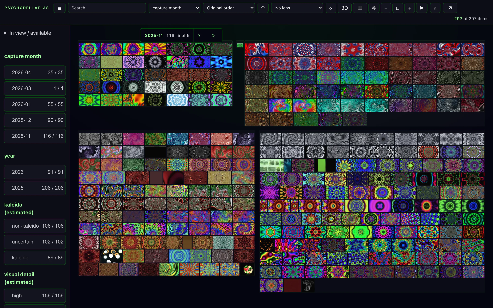](https://andyed.github.io/clipwall-demo/)

[Try the wall ↗](https://andyed.github.io/clipwall-demo/) ·
[Spatial aisle ↗](https://andyed.github.io/clipwall-demo/?view=aisle&group=year) ·
[Read the guide](../../references/collections.md) ·
[View source ↗](https://github.com/andyed/wunderkammer/tree/v0.3.0)

### Linked Atlas

Brush a cohort of synthetic observations, zoom into it, and compare the same
selection across the overview, detail plot, habitat breakdown, and record table.
The example makes selection identity and recovery inspectable.

[Try the demo](../linked-atlas/index.html) ·
[Read the guide](../../references/multiscale-coordination.md) ·
[View source ↗](https://github.com/andyed/muriel/tree/main/plugins/muriel/skills/compose/examples/linked-atlas)

## Spatial exploration

### Orbital Sunburst

Compare a conventional sunburst with an exploded hierarchy in depth. The same
partition supports pointer and keyboard navigation, with a linear phone layout.

[Try the demo](https://muriel.mindbendingpixels.com/gallery/orbital-sunburst/index.html) ·
[Read the guide](../../channels/spatial.md#the-orbital-sunburst-path-hierarchy-becomes-depth) ·
[View source ↗](https://github.com/andyed/muriel/tree/main/render_assets/orbital-sunburst)

### Spatial typography

Selectable DOM text, images, and bookmark cards share a perspective scene.
Explore how depth changes emphasis and legibility.

[Try the demo](https://muriel.mindbendingpixels.com/gallery/spatial-typography/index.html) ·
[Read the guide](../../vocabularies/visible-language.md) ·
[View source ↗](https://github.com/andyed/muriel/tree/main/render_assets/spatial-typography)

### MindBendingPixels Mountain

Inspect ten product cards arranged on a tilted plane; click a card to bring it
forward while the surrounding collection stays in place.

[Try the demo](https://muriel.mindbendingpixels.com/gallery/mindbendingpixels-mountain/index.html) ·
[Read the guide](../../channels/spatial.md) ·
[View source ↗](https://github.com/andyed/muriel/tree/main/render_assets/mindbendingpixels-mountain)

### Perspective Wall

Move through a sixteen-item timeline on a bent ribbon. The frontal panel shows
detail while the folded sides retain context.

[Try the demo](https://muriel.mindbendingpixels.com/gallery/perspective-wall/index.html) ·
[Read the guide](../../channels/spatial.md) ·
[View source ↗](https://github.com/andyed/muriel/tree/main/render_assets/perspective-wall)

### Data Mountain at field scale

An experimental renderer study combines a large field of GPU tiles with a small
set of detailed DOM cards. Use it to inspect the rendering approach; it is not a
cross-device performance guarantee.

[Try the study](https://muriel.mindbendingpixels.com/gallery/data-mountain-field/index.html) ·
[Read the guide](../../channels/spatial.md) ·
[View source ↗](https://github.com/andyed/muriel/tree/main/render_assets/data-mountain-field)

### Fictional communication studies

Two synthetic-content studies apply the spatial layouts to a fictional imageboard
and conversation. They are design demonstrators, not records of real events.

- **AgentChan Mountain:** four colour-zoned boards on a tilted plane.
  [Try the demo](https://muriel.mindbendingpixels.com/gallery/sciprogfi-agentchan-mountain/index.html) ·
  [Read the guide](../../channels/spatial.md) ·
  [View source ↗](https://github.com/andyed/muriel/tree/main/render_assets/sciprogfi-agentchan-mountain)
- **Lux Mesh Wall:** step through twenty selected posts on a perspective ribbon.
  [Try the demo](https://muriel.mindbendingpixels.com/gallery/sciprogfi-lux-mesh-wall/index.html) ·
  [Read the guide](../../channels/spatial.md) ·
  [View source ↗](https://github.com/andyed/muriel/tree/main/render_assets/sciprogfi-lux-mesh-wall)

## Interface, type, and motion

- **FUI telemetry HUD:** four panels demonstrate readouts, a bearing compass,
  a waveform, and status. [Try the demo](../fui-scaffold.html) ·
  [Read the guide](../../vocabularies/fui.md) ·
  [View source ↗](https://github.com/andyed/muriel/blob/main/plugins/muriel/skills/compose/examples/fui-scaffold.html)
- **Interactive colophon:** adjust the constraints behind Muriel’s six-bar mark.
  [Try the demo](../logos/output/colophon/interactive-colophon.html) ·
  [Read the guide](../../vocabularies/muriel-brand.md) ·
  [View source ↗](https://github.com/andyed/muriel/blob/main/plugins/muriel/skills/compose/examples/logos/output/colophon/interactive-colophon.html)
- **Bauhaus M:** a geometric construction resolves into a wordmark.
  [Try the demo](../logos/output/bauhaus/animated-bauhaus-m.html) ·
  [Read the guide](../../vocabularies/kinetic-typography.md) ·
  [View source ↗](https://github.com/andyed/muriel/blob/main/plugins/muriel/skills/compose/examples/logos/output/bauhaus/animated-bauhaus-m.html)
- **Motion tuner:** adjust duration, easing, and stagger, then copy the TOML.
  [Try the tuner](https://muriel.mindbendingpixels.com/showcase/#motion-tuner) ·
  [Read the guide](../../channels/style-guides.md) ·
  [View source ↗](https://github.com/andyed/muriel/blob/main/site-docs/src/showcase/index.html)
- **Approach / Retreat:** inspect cursor-distance dynamics over search results.
  [Try the external demo ↗](https://andyed.github.io/approach-retreat/) ·
  [Read the guide](../../channels/gaze.md) ·
  [View source ↗](https://github.com/andyed/approach-retreat)

## HyperFrames films

Watch two finished cuts in the [showcase’s film section](https://muriel.mindbendingpixels.com/showcase/#hyperframes).
Playback starts when you choose it; both include written scene descriptions.

- **Cats. Lots of cats.** — Wunderkammer’s 28-second silent collection tour:
  a rushing aisle, facets, colour placement, and linked evidence.
  [Watch on YouTube ↗](https://www.youtube.com/watch?v=FGobAjvw32g) ·
  [Play the preview](https://muriel.mindbendingpixels.com/showcase/#wunderkammer-film) ·
  [Production notes](../hyperframes.md#cats-lots-of-cats) ·
  [Collection guide](../../references/collections.md)
- **Psychodeli spatial reel** — 39 seconds of moving video tiles, camera
  choreography, and a branded ending, set to music.
  [Watch the reel](https://muriel.mindbendingpixels.com/showcase/#psychodeli-film) ·
  [Production notes](../hyperframes.md#psychodeli-spatial-reel) ·
  [Video guide](../../channels/video.md#html-mp4-via-hyperframes)

## Worked artifacts

These examples connect finished work to its tools and recipes. Linked project
pages are hosted outside this documentation; runnable generators link to source.

### 0. muriel's own hero mark — Raster + Kinetic Typography + Visible Language

<p align="center">
  <picture>
    <source srcset="../../../../../../assets/logo-animated-dark.gif" media="(prefers-color-scheme: dark)">
    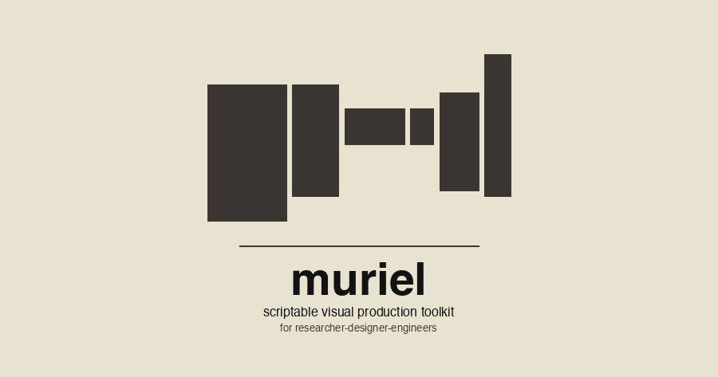
  </picture>
</p>

**Tools:** Pillow (still frame composition) · a custom 12-pose renderer (iterates frame_0..frame_11.png) · ffmpeg or ImageMagick `convert -delay -loop 0` (GIF assembly) · `muriel.contrast.audit_svg` (8:1 text-rule check before ship).
**Channels:** [`raster`](../../channels/raster.md), [`svg`](../../channels/svg.md), [`video`](../../channels/video.md).
**Vocabularies:** [`visible-language`](../../vocabularies/visible-language.md) (Cooper's mitp colophon reinterpreted), [`kinetic-typography`](../../vocabularies/kinetic-typography.md) (strategic motion, max contrast).
**Pattern:** same mark, four variants — still + animated × light + dark — served via `<picture>` + `prefers-color-scheme`. Assets at [`assets/`](../../../../../../assets/).

*The rest of the gallery points at other shipped work that exemplifies each channel in its own right. Source blog posts live under [the Scrutinizer dev log](https://andyed.github.io/scrutinizer-www/blog/); this gallery references them, it doesn't host them.*

---

### 1. Before / after comparison panel — Raster

[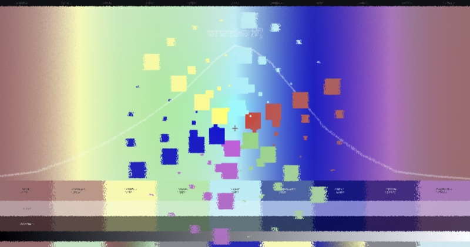](https://andyed.github.io/scrutinizer-www/blog/2026-03-16-color-sprint.html) [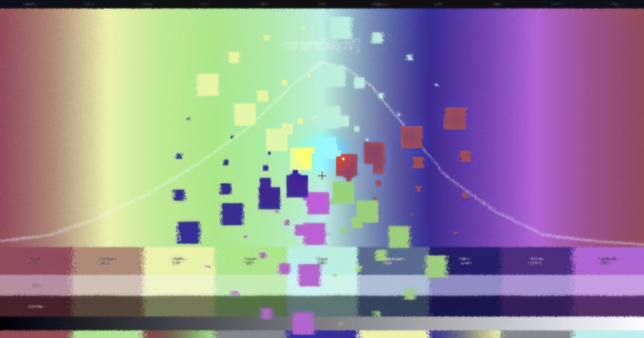](https://andyed.github.io/scrutinizer-www/blog/2026-03-16-color-sprint.html)

**Tools:** Pillow (image composition + draw) · matplotlib (curve overlay rendered as PNG, then composited) · [`muriel/typeset.py`](https://github.com/andyed/muriel/blob/main/muriel/typeset.py) (caption typography) · [`muriel/contrast.py`](https://github.com/andyed/muriel/blob/main/muriel/contrast.py) (pre-ship 8:1 audit).
**Channel:** [`channels/raster.md`](../../channels/raster.md).
**Pattern:** canonical small-multiples A/B — identical framing, variable stimulus.
**Live:** [Color sprint →](https://andyed.github.io/scrutinizer-www/blog/2026-03-16-color-sprint.html)

---

### 2. Mode comparison — Raster (interactive → captured)

[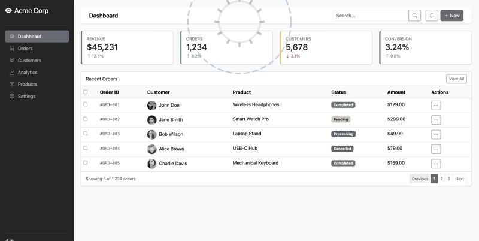](https://andyed.github.io/scrutinizer-www/blog/2026-03-21-v2.6.html) [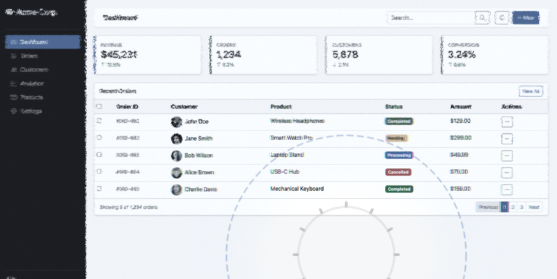](https://andyed.github.io/scrutinizer-www/blog/2026-03-21-v2.6.html)

**Tools:** a WebGL foveation engine (external, Scrutinizer) for the rendering · [`muriel/capture.py`](https://github.com/andyed/muriel/blob/main/muriel/capture.py) (`capture_responsive()` for retina screenshots) · Pillow (side-by-side composition) · [`muriel/dimensions.py`](https://github.com/andyed/muriel/blob/main/muriel/dimensions.py) (`OG_CARD` for final size).
**Channel:** [`channels/raster.md`](../../channels/raster.md) (captured from [`channels/interactive.md`](../../channels/interactive.md)).
**Pattern:** same stimulus, two processing modes — small multiples across a parameter axis.
**Live:** [v2.6 release notes →](https://andyed.github.io/scrutinizer-www/blog/2026-03-21-v2.6.html)

---

### 3. Reading-span A/B — Science

[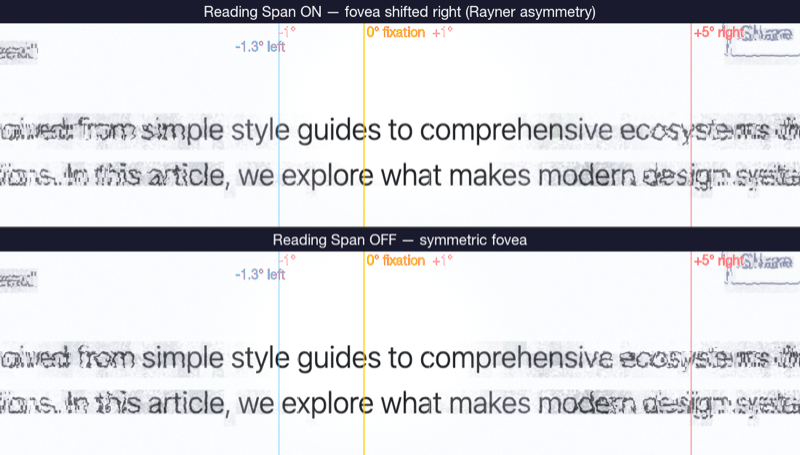](https://andyed.github.io/scrutinizer-www/blog/2026-03-13-reading-span.html)

**Tools:** matplotlib (figure composition with two `subplot` panels, body-text rendering via `ax.text()` or imported image, degree-of-visual-angle guides as `axvline`) · [`muriel/matplotlibrc_dark.py`](https://github.com/andyed/muriel/blob/main/muriel/matplotlibrc_dark.py) (palette + rcparams) · [`muriel/dimensions.py`](https://github.com/andyed/muriel/blob/main/muriel/dimensions.py) (`figsize_for('chi', columns=2)`) · [`muriel/stats.py`](https://github.com/andyed/muriel/blob/main/muriel/stats.py) (`format_comparison()` for the effect-size caption).
**Channel:** [`channels/science.md`](../../channels/science.md).
**Pattern:** paired-conditions comparison with labeled axes, effect size, and sample size — exactly what `muriel.stats.format_comparison()` formats into a figure caption.
**Live:** [Reading span on/off →](https://andyed.github.io/scrutinizer-www/blog/2026-03-13-reading-span.html)

---

### 4. Saliency vs. congestion — Science

[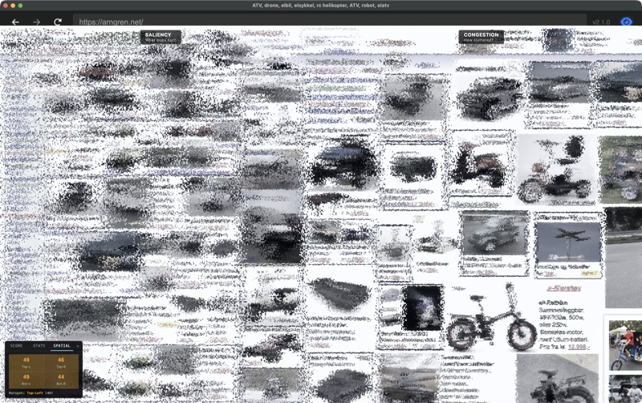](https://andyed.github.io/scrutinizer-www/blog/congestion-score.html)

**Tools:** matplotlib (dense small-multiples grid, `GridSpec` or `subplot_mosaic`) · numpy / polars (derived metric computation) · [`muriel/matplotlibrc_dark.py`](https://github.com/andyed/muriel/blob/main/muriel/matplotlibrc_dark.py) · [`muriel/dimensions.py`](https://github.com/andyed/muriel/blob/main/muriel/dimensions.py) (`figsize_for('chi', columns=2)` for IEEE/CHI venue width).
**Channel:** [`channels/science.md`](../../channels/science.md).
**Pattern:** stacked small-multiples for visual diagnostic review — multiple derived metrics against one source image.
**Live:** [Congestion score →](https://andyed.github.io/scrutinizer-www/blog/congestion-score.html)

---

### 5. Color foveation demo — Interactive captured to Raster

[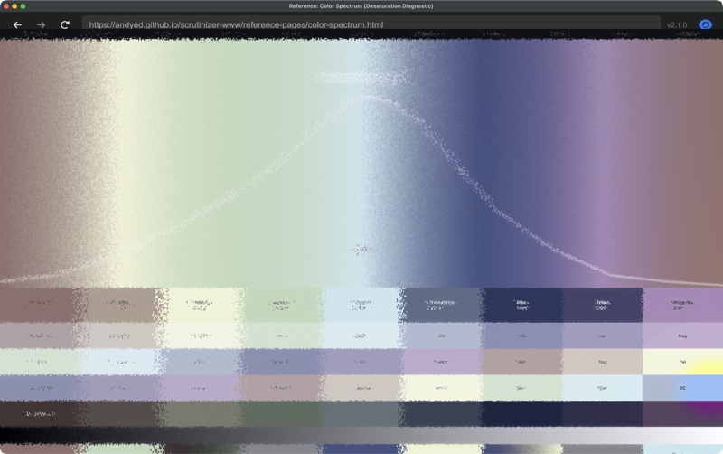](https://andyed.github.io/scrutinizer-www/blog/color-search.html)

**Tools:** a live WebGL demo (external) for the interactive itself · [`muriel/capture.py`](https://github.com/andyed/muriel/blob/main/muriel/capture.py) (`capture_responsive()` with retina scale factor) · Pillow (crop + composite for editorial placement) · [`muriel/contrast.py`](https://github.com/andyed/muriel/blob/main/muriel/contrast.py) (audit for annotations).
**Channel:** [`channels/interactive.md`](../../channels/interactive.md) captured into [`channels/raster.md`](../../channels/raster.md).
**Pattern:** the live version stays interactive; the raster snapshot goes into social cards + paper figures.
**Live:** [Color search →](https://andyed.github.io/scrutinizer-www/blog/color-search.html)

---

### 6. Icon analysis pair — Raster + SVG

[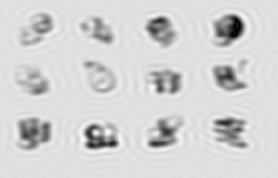](https://andyed.github.io/scrutinizer-www/blog/color-search.html) [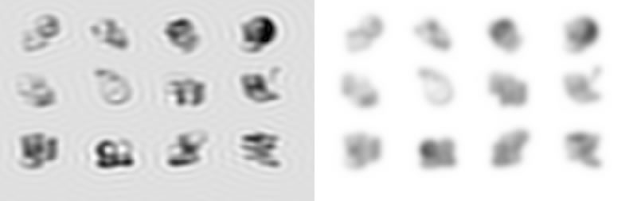](https://andyed.github.io/scrutinizer-www/blog/color-search.html)

**Tools:** Pillow (thumbnail resize + compositing) · a Gaussian-blur variant (Pillow's `ImageFilter.GaussianBlur`) · [`muriel/typeset.py`](https://github.com/andyed/muriel/blob/main/muriel/typeset.py) (label typography) · SVG (hand-rolled or `svgwrite`) for accompanying diagrams in the post.
**Channels:** [`channels/raster.md`](../../channels/raster.md) + [`channels/svg.md`](../../channels/svg.md).
**Pattern:** micro-comparison at icon scale — two ~256-px tiles laid out inline in editorial prose. When a full figure is overkill.

---

### 7. V1 orientation columns — Diagrams + SVG (runnable)

[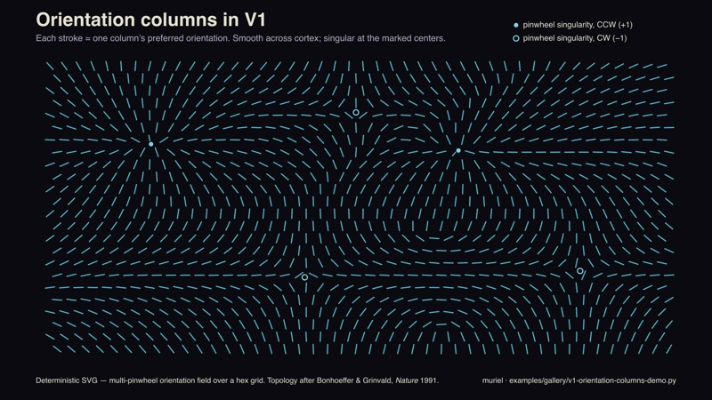](https://github.com/andyed/muriel/blob/main/plugins/muriel/skills/compose/examples/gallery/v1-orientation-columns-demo.py)

**Tools:** pure Python stdlib (`math`) emitting SVG directly — a multi-pinwheel orientation field over a hex grid, hand-rolled `<line>` + `<circle>` elements with brand tokens inlined from `examples/muriel-brand.toml` (OLED palette, 8:1+ contrast on every text element).
**Channels:** [`channels/diagrams.md`](../../channels/diagrams.md) + [`channels/svg.md`](../../channels/svg.md), with [`channels/science.md`](../../channels/science.md) sensibility (cited primary literature in the footer).
**Pattern:** deterministic SVG diagram replacing an AI-generated raster — every stroke is a function of position, the topology is reproducible, the file diff-able. Pinwheel singularities marked; one is annotated as a worked-example legend.
**Run:** `python examples/gallery/v1-orientation-columns-demo.py` → writes `docs/v1-orientation-columns.svg`.
**Why it's here:** the deterministic-SVG ethos in one file. Scientific basis: Hubel & Wiesel (1962) orientation selectivity; Bonhoeffer & Grinvald (*Nature* 1991) pinwheel topology.

---

### 8. Warm editorial web page — Web

[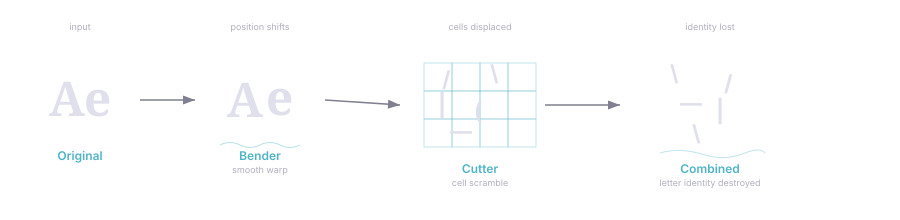](https://andyed.github.io/attentional-foraging/explainer/)

**Tools:** marginalia (editorial CSS library, external) · `marginalia-md.js` (markdown → marginalia HTML in the browser) · a Node build script · custom CSS for the F-explainer's light palette extensions (`.outer-note`, `.stats-detail`, `.has-dropcap`) · [`muriel/matplotlibrc_light.py`](https://github.com/andyed/muriel/blob/main/muriel/matplotlibrc_light.py) (for any inline figures to match the warm editorial palette).
**Channel:** [`channels/web.md`](../../channels/web.md) — marginalia + warm editorial light palette.
**Pattern:** long-form explainer with pull-quotes, margin notes, inline stats spans, drop-cap.
**Live:** [Attentional Foraging F-pattern explainer →](https://andyed.github.io/attentional-foraging/explainer/)
*The preview is a diagram from the explainer; the linked page contains the full editorial layout.*

---

### Refreshing thumbnails

All thumbnails live in [`thumbs/`](thumbs/). Resized to 800px wide max and re-encoded as JPG (85% quality) for files above ~500 KB. If a blog post updates its hero image, re-run:

```bash
sips -Z 800 -s format jpeg -s formatOptions 85 source.png --out thumbs/source.jpg
```
